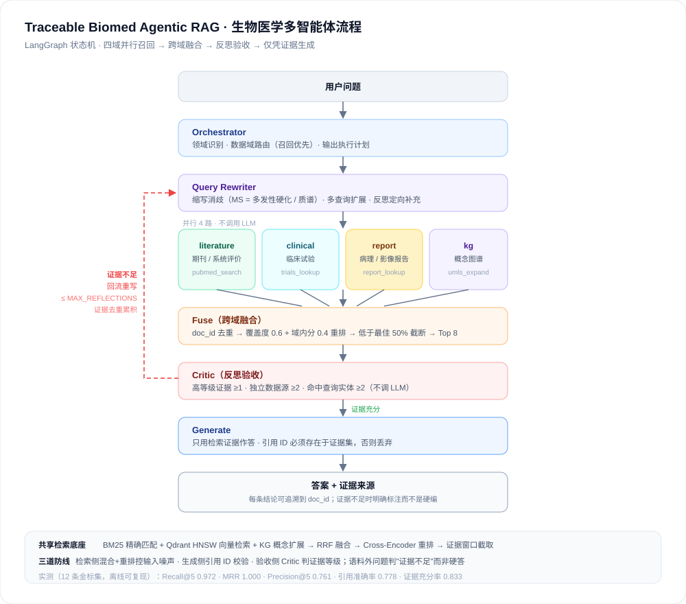

# Traceable Biomed Agentic RAG · 多智能体决策链与引用溯源

[](LICENSE)
[](pyproject.toml)
[](tests)

[](https://github.com/a2012s/traceable-biomed-agentic-rag/actions)

基于 **LangGraph** 的多智能体 Agentic RAG 参考实现：按数据域拆分的四个专职 agent 并行召回，
经跨域融合与 Critic 反思验收后生成**每条结论都可溯源**的回答。

> A domain-agnostic Agentic RAG skeleton: planning/reflection lives in the graph,
> domain knowledge lives in three replaceable modules (corpus, prompts, tools).
> 完整流程见 [docs/architecture.svg](docs/architecture.svg)。



> ⚠️ **数据声明**：内置语料为虚构教学数据，PMID / NCT 编号与真实记录无关，**禁止用于任何真实医疗决策**。
> 详见 [DISCLAIMER.md](DISCLAIMER.md)。

---

## 1. 快速开始

```bash
git clone <this-repo> && cd traceable-biomed-agentic-rag

# 无需 API Key：默认 Mock 规则引擎 + 本地 TF-IDF 向量 + 内存 Qdrant，离线跑通全流程
uv venv .venv && source .venv/bin/activate
uv pip install -e ".[real-vector]"

python run.py "MS 的诊断标准是什么？"
python eval.py                      # 检索评估，秒级，不烧 token
python -m unittest discover -s tests -t .   # 76 项单元/行为测试
```

`pip` 同样可用：`pip install -e ".[real-vector]"`。

### 交互式 Web 演示

单页演示把运行时状态直接画出来：决策链时间线（并行 fan-out、反思回流）、跨域融合后的证据卡片、
回答内可点击并跳转到证据的引用高亮。

```bash
uv pip install -e ".[web]"
uvicorn web.server:app --host 127.0.0.1 --port 8765
# 浏览器打开 http://127.0.0.1:8765
```

后端默认强制 `LLM_PROVIDER=mock`——即使本机 `.env` 配了真实 key，演示页也不会触发付费调用；
只有显式设 `WEB_ALLOW_REAL_LLM=1` 才允许切真实模型。分享部署时页面会把 `sharecode` 透传到 API 请求。

## 2. 切到真实模型

```bash
cp .env.example .env
```

任选一家 OpenAI 兼容端点，填 key 即可（`LLM_PROVIDER` 决定用哪家）：

| 供应商 | `LLM_PROVIDER` | 需要填 |
|---|---|---|
| OpenAI | `openai` | `OPENAI_API_KEY` |
| DeepSeek | `deepseek` | `DEEPSEEK_API_KEY` |
| 阿里云百炼 | `dashscope` | `DASHSCOPE_API_KEY` |

key 为空或 `LLM_PROVIDER=mock` 时自动降级到规则引擎，链路照常运行。

**延迟提示**：若主模型是推理型（如 `qwen4-max-preview`），把 `CHEAP_MODEL` 指向非推理模型
（如 `qwen-plus`）——查询重写走 cheap 档。实测重写节点从 134s 降到 12s，端到端从 265s 降到 30s。

## 3. 它到底解决了什么

通用 RAG 的问题不是"检索不到"，而是**错了也不知道**：单路检索漏召回、排序靠后、
检索到却不相关、生成时补脑。本项目针对每一环放一道工程约束：

| 环节 | 做法 | 消掉的问题 |
|---|---|---|
| Query Rewriting | UMLS 风格缩写消歧 + 多查询扩展 | "问法不对 → 检索跑偏"（MS = 多发性硬化/质谱） |
| 三路混合召回 | BM25 精确匹配 + Qdrant HNSW 向量 + KG 概念扩展，RRF 融合 | 单一召回漏检：药名/基因名靠 BM25，语义靠向量，概念靠图谱 |
| 跨域融合 | 按 `doc_id` 去重 → 按分数全局重排 → 丢弃低于最佳 50% 的片段 | 各域各自取 Top-k 后直接拼接，生成只看到单一数据域；通用词偶然命中会污染引用 |
| Critic 反思 | 高等级证据 ≥1、独立数据源 ≥2、命中实体 ≥2，否则回流重写（有轮次上限） | "证据不足仍强行生成" |
| 人工确认断点 | 机器本来还要再检索一轮时，图在 `human_review` 节点暂停并返回确认单；人工选继续 / 按补充说明再检索 / 中止后续跑 | "机制判断不了该不该继续，却只会两种反应：闷头烧钱，或武断拒答" |
| 引用校验 | 生成结果里的 citation 必须存在于证据集 | 编造引用（幻觉最容易被发现的一种） |
| 语料外拒答 | 打分只用「原问题 + 缩写展开」，不用重写后的通用词 | 重写器追加的 "systematic review" 让任何文档都"相关"→ 假 grounded |

## 4. 实测数据（离线可复现）

12 条金标集（9 dev / 3 test holdout），覆盖四种数据域、缩写消歧、跨域干扰；
`python eval.py` 秒级复现检索指标，`LLM_PROVIDER=mock python eval.py --full` 复现端到端指标（无需 key）。
每次 eval 把逐样本明细与 95% bootstrap 置信区间写入 `eval_runs/<timestamp>/`，
指标掉了能直接定位到具体 case。

**口径说明**：第 1 行为检索-only（实体链接前），第 2–3 行为实体链接引入前的端到端口径（需加 `ENTITY_LINKING=0`），
第 4 行为当前默认（`ENTITY_LINKING=1`）。四行是不同配置下的实测，不是同一配置的不同版本。

| 配置 | Recall@5 | MRR | Precision@5 | 引用准确率 | 干扰泄漏 | 证据充分率 |
|---|---|---|---|---|---|---|
| 单路全局检索（基线） | 0.917 | 0.917 | 0.639 | — | — | — |
| 多 agent · 编排器裁剪数据域（`WIDE_RECALL=0`） | 0.951 | 1.000 | 0.800 | 0.812 | 0.083 | 0.833 |
| 多 agent · 全量召回 + 跨域融合（实体链接前） | **0.972** | **1.000** | 0.775 | 0.792 | 0.153 | 0.833 |
| **多 agent · 全量召回 + 实体链接（默认）** | 0.910 | 0.958 | **0.786** | **0.799** | **0.083** | 0.833 |

复现命令（由上到下）：

```bash
ENTITY_LINKING=0 python eval.py                                              # 基线（检索-only）
WIDE_RECALL=0 ENTITY_LINKING=0 LLM_PROVIDER=mock python eval.py --full       # 窄召回
WIDE_RECALL=1 ENTITY_LINKING=0 LLM_PROVIDER=mock python eval.py --full       # 全量召回（实体链接前）
LLM_PROVIDER=mock python eval.py --full                                      # 默认（实体链接开）
```

四条同金标集、同 embedding；只需改环境变量，无需改代码。若直接跑 `python eval.py` 且
`ENTITY_LINKING=1`（默认），检索-only 的 MRR 是 0.875，不是表中基线的 0.917——
这是实体链接对 eGFR/EGFR 另一义项降权的预期结果。

LLM 自主工具选择（默认开，`TOOL_USE_ENABLED=0` 可关）让工具返回的文档经同一 reranker
打分后进入证据链。实测端到端 Precision 提升 0.772→0.786（默认档）、0.772→0.800（窄召回档），
引用准确率同步上升，干扰泄漏不变——工具调用对答案是真实贡献，不是 trace 装饰。

这张表最值得讲的不是"默认配置最好"，而是**每一项改动都能被指标证伪**：

1. **编排器裁剪数据域仍会掉召回**：全量 0.972 → 窄召回 0.951。规则路由枚举不全
   （"brain MRI demyelination" 匹配不到任何领域关键词 → 报告域没被分派）；窄召回靠工具
   调用补回了一部分（旧值 0.868，开启工具选择后 0.951），但仍低于全量召回。所以默认
   `WIDE_RECALL=1`，只在明确无关时裁剪。专家 agent 不调 LLM，多跑一路是毫秒级成本，
   漏一路却少一条证据。
2. **跨域融合决定多源证据能不能进上下文**：各域各取 Top-5 直接拼接，生成节点只看得到
   第一个数据域那几条；融合节点按 `doc_id` 去重、按分数全局重排、丢掉低于最佳 50% 的片段，
   MRR 从 0.917 提到 1.000。
3. **打分必须用消歧后的查询**：早期用重写器的输出打分，`systematic review` 这类通用词
   让语料外问题也被判"证据充分"；改成「缩写就地铁换成语境义项」后，假 grounded 消失，
   语料外问题（CRISPR 治疗镰状细胞病）稳定返回"证据不足"——这条有单测锁定。
4. **代价与取舍说清楚**：全量召回曾把干扰泄漏从 0.083 抬到 0.153，换来召回 +0.104、MRR +0.083。
   加实体链接后（默认开）干扰泄漏回落到 0.083、引用准确率升到 0.799、Precision 升到 0.786，
   但召回 0.972 → 0.910、MRR 1.000 → 0.958 —— 这是"少引用错文档"换"少召回一条对文档"的主动取舍，
   可通过 `ENTITY_LINKING=0` 退回召回优先档。宽/窄召回仍由 `WIDE_RECALL` 控制。

> 小样本提醒：12 条样本（9 dev / 3 test）用于**回归对比**，不能当作生产精度。
> 默认配置的 95% bootstrap 区间：Recall [0.75, 1.0]、MRR [0.667, 1.0]、Precision [0.456, 0.822]——
> 宽度说明小样本上 0.910 与 0.972 的差异无法区分信号与噪声。分层报告也印证了这点：
> dev 9 条 Recall 1.000，test 3 条只有 0.667。别拿这些绝对值对外宣称精度。

## 5. 代码结构

```
src/
├─ agents/
│  ├─ graph.py        状态机：条件边、并行 fan-out、反思回流、HITL 断点、checkpointer
│  ├─ nodes.py        编排 / 重写 / 工具选择 / 四域 agent（工厂）/ 融合 / 反思 / 人工确认 / 生成
│  ├─ prompts.py      提示词集中管理，便于迭代与评估
│  └─ tool_params.py  工具入参抽取：查询 ∩ 语料词表，不硬编码领域名词
├─ rag/
│  ├─ retriever.py    BM25 + 向量 + KG 三路召回，RRF 融合
│  ├─ reranker.py     IDF 加权余弦打分（cross-encoder 占位）+ 跨域融合 + 证据窗口
│  ├─ embedding.py    可插拔 Embedding：hash / tfidf / api（真模型）
│  └─ vector_store.py Qdrant 本地 HNSW + numpy 兜底，同一接口
├─ tools/biomedical.py  ToolSpec 单注册表：Pydantic 校验、异步、错误二分、MCP schema 导出
├─ eval/               金标集、检索/生成指标、评估运行器（bootstrap CI、逐样本落盘）
├─ deps.py             懒加载依赖容器（import 不触发建索引）
├─ state.py            共享状态与 reducer（去重累积 / 累加计量）
└─ llm.py              真实/Mock 双模式、分层路由、指数退避、真实 token 计量

web/
├─ server.py           FastAPI：/api/ask（含 interrupted 契约）、/api/ask/resume、SSE、metrics
└─ index.html          单页演示：决策链、证据卡片、引用高亮、人工确认面板
```

## 6. 设计决策与依据

| 决策 | 做法 | 为什么 |
|---|---|---|
| 按数据域拆 agent，而非按功能 | literature / clinical / report / kg 各自持有数据源与专属工具 | 数据域异构且权限边界不同；按域拆才能并行召回、独立扩缩容、分别评估 |
| 状态机而非 prompt chain | `StateGraph` + 条件边 + `MemorySaver` | 反思是有环图，需要显式迭代上限与断点续跑；对话式链路表达不了回退 |
| 召回与打分分离 | 重写后的查询只用于**召回**，打分用「原问题 + 缩写展开」 | 重写为了放宽召回必然引入通用词，用它打分会让无关主题"被覆盖" |
| 证据去重累积而非重置 | reducer 按 `doc_id` 合并，保留高分项 | 早期"反思即清空"的实现让反思一轮就把上一轮有效证据全丢了，多跑一轮反而更差 |
| 多义缩写按语境选义项 | 线索词表判定（诊断/影像 → 疾病义；定量/色谱 → 方法义），无线索才保留全部 | 无脑扩展全部义项，问"诊断标准"会把质谱方法学论文召回并引用 |
| 融合后按相对分截断 | 低于最佳证据 50% 的丢弃 | 单个通用词偶然命中（`mass effect` 撞 `mass spectrometry`）会污染引用；绝对阈值跨查询不可比 |
| 依赖懒加载 | `deps.py` 用 `lru_cache` | 模块顶层建索引会让 `import` 付出全量代价，也让测试无法注入替身 |
| 错误二分 | 超时/429 → 指数退避重试；参数非法/未知工具 → 立即失败 | 前者状态可恢复，重试有意义；后者重试只会放大成本 |
| 单注册表 | `ToolSpec(name, schema, handler, description)` | 早期 handler 与 schema 分两处维护，加工具必忘一处；现在还能直接导出 MCP schema |
| LLM 自主工具选择 | `tool_use` 节点与 query_rewriter 并行，模型看 schema 选工具，结果进证据链 | 固定工具映射只是 trace 装饰；实测自主选择让默认档 Precision +0.014、引用准确率 +0.014 |
| 多轮只传文本不传状态 | `history` 只把 Q/A 文本送进 query_rewriter 做指代消解，不复用 thread 内部状态 | 复用状态会让上一轮的 evidences/reflection_count 泄漏到新问题，出现"越聊越离谱" |
| HITL 用图内断点而非外部队列 | `interrupt()` 停在 `human_review` 节点，`Command(resume=...)` 从该点续跑 | 断点状态由 checkpointer 保存，人工决定后不必重跑前面的检索与反思；外部队列得自己维护中间态 |
| HITL 默认关 | `HITL_ENABLED=0`，只有 Web 演示显式开启 | `eval.py` 与批处理无人值守，中断会让进程停在等人这一步——默认开等于把离线评测挂死 |
| 评测留出 holdout | 12 条切成 9 dev / 3 test，test 不参与调参；落逐样本 jsonl 与 bootstrap CI | 同一批样本既调参又报告会有乐观偏差；分层报告实测 dev Recall 1.000 vs test 0.667 |
| 测试强制离线 | `tests/__init__.py` 里设 `LLM_PROVIDER=mock` | 否则本地跑测试会打到 `.env` 里的付费 API（真实踩过） |

## 7. 哪些是真的，哪些是模拟的

诚实标注比"看起来完整"更重要——真实边界写清楚，使用者才能正确评估能不能用：

| 模块 | 状态 |
|---|---|
| LangGraph 编排、条件边、反思回流、状态 reducer | ✅ 真实实现 |
| 三路召回 + RRF + 重排 + 证据窗口 | ✅ 真实算法（重排是特征打分，非神经网络） |
| Qdrant 本地 HNSW / numpy 兜底 / 维度变更重建 | ✅ 真实实现 |
| TF-IDF Embedding | ✅ 真实计算（离线可跑，非语义模型） |
| hash Embedding | ⚠️ 降级兜底，语义能力弱；用 crc32 投影，跨进程可复现（不用随机化的 `hash()`） |
| Cross-Encoder 重排 | ⚠️ 用 IDF 加权余弦 + 先验模拟，`score()` 换成 bge-reranker 即可 |
| 四个生物医学工具 | ⚠️ 本地语料模拟，`pubmed_search` 等替换为真实 API 即可 |
| LLM 工具选择 | ✅ 真实调用链（模型输出 → Pydantic 校验 → dispatch → reranker → 证据）；mock 模式用领域规则模拟 |
| 多轮指代消解 | ⚠️ 上下文传递与缓存隔离是真实的；mock 模式用词表反查做启发式消解，真实模型用 prompt 完成 |
| 人工确认断点 | ✅ LangGraph `interrupt` + `Command(resume)` 真实暂停/续跑，三种决定各走独立出口；断点存活范围受 checkpointer 限制 |
| 95% 置信区间 | ✅ bootstrap 重采样实现；但 n=12 区间很宽，只标注不确定性，不构成显著性结论 |
| Critic | ⚠️ 规则判定（可解释、零成本），非 LLM judge |
| 语料 | ⚠️ 虚构教学数据，编号与真实记录无关 |

生产化只改三处：`build_index()` → 真实数据源、`EMBEDDING_BACKEND=api` → 领域 embedding、
`CrossEncoderReranker.score()` → 真实重排模型。编排层不用动。

## 7.5 生产化增量

以下能力都**默认关闭或退化为原行为**，开箱即用的离线 Demo 不受影响；配置项见 `.env.example`。

| 能力 | 开关 | 实现与依据 |
|---|---|---|
| 持久化检查点 | `CHECKPOINTER=sqlite` + `uv pip install -e ".[production]"` | 换掉 `MemorySaver`，重启/多 worker 可按 thread_id 续跑；缺依赖自动降级内存并告警 |
| 并发与超时 | `MAX_CONCURRENCY` / `REQUEST_TIMEOUT_S` | Web 层 `Semaphore` + `wait_for`，避免多请求打满检索线程 |
| 可观测性 | 默认开 | `X-Request-ID` 贯穿响应头与响应体；`/api/metrics` 给出请求数、错误数、P50/P95/P99、缓存命中率 |
| 答案缓存 | `ANSWER_CACHE_TTL_S` | 键含语料版本摘要、embedding/检索配置、模型档位；换配置不会吃到旧答案 |
| 实体链接 | `ENTITY_LINKING=1` | `eGFR`（肾功能）与 `EGFR`（基因）同形异义，对另一义项证据降权而非硬删；端到端干扰泄漏 0.153 → 0.083 |
| 外部重排 | `RERANKER_API_URL` | POST `{query,text}` → `{score}`，接真 cross-encoder；失败熔断降级内置打分 |
| 流式接口 | 默认开 | `POST /api/ask/stream` SSE；当前推送粒度为整条链路完成，token 级需改 generate 节点 |
| 反馈闭环 | `FEEDBACK_ENABLED=1` | `/api/feedback` + `/api/feedback/summary`，SQLite 事务写入，**只存问题哈希不存原文** |
| 检索鲁棒性 | `FUSE_MIN_KEEP` / `RRF_K` / `RERANK_CANDIDATES` | 融合保底防止"最佳项离群→只剩 1 条→必然拒答"；RRF 先过滤再排名，单域检索不再被摊薄；重排只取前 N 条候选 |
| 成本闸门 | `MAX_TOKENS_PER_REQUEST` | 反思除轮次上限外，再加 token 预算与"本轮零新增证据"早停，避免枯竭查询空转 |
| 外部重排熔断 | `RERANKER_TIMEOUT_S` / `RERANKER_BREAKER_COOLDOWN_S` | 批量请求（不再逐文档发 HTTP）+ 实例级熔断，失败不改写全局配置 |
| 人工确认断点 | `HITL_ENABLED=1` | Critic 判不足且机器本来还要再检索时，`POST /api/ask` 返回 `interrupted=true` + 确认单，`POST /api/ask/resume` 带 `thread_id` + 决定续跑（见下方代码块） |

HITL 的三种决定：`approve` 带不确定性继续生成（证据不变，`grounded` 仍为 false）；
`refine` 把人工补充说明拼进 `query_focus` 再检索一轮（计入反思轮次，不能靠反复点绕过 `MAX_REFLECTIONS`）；
`abort` 走独立 `refuse` 节点直接拒答，**不调用生成模型**。

```bash
# 1) 中断：Critic 判证据不足，图停在 human_review
curl -s localhost:8765/api/ask -H 'Content-Type: application/json' \
  -d '{"question":"mass spectrometry 质谱分析在血清蛋白定量中的应用"}'
# → {"interrupted": true, "thread_id": "web-…", "review": {"critique": "…", "options": [...] }}

# 2) 续跑：三种决定之一，可带补充说明
curl -s localhost:8765/api/ask/resume -H 'Content-Type: application/json' \
  -d '{"thread_id":"web-…","decision":"refine","note":"只看血清蛋白定量"}'
# → {"interrupted": false, "review_decision": "refine", "reflection_count": 1, "answer": "…"}
```

已完成的 thread 再调 resume 返回 409（不会悄悄重跑一遍重复计费），`decision` 非法返回 422。

实测：`python -m unittest discover -s tests -t .` 76 项通过；`python eval.py` 与 `python eval.py --full` 指标未退化。

仍属 Demo 范畴、没有假装完成的部分：真实语料与版本过滤、token 级流式、多实例共享检查点/指标/反馈（当前是进程内）、
速率限制与鉴权（当前只有并发上限）。这些需要外部资源，代码留了接口但没有虚构实现。

## 8. 领域迁移

领域绑定只有三处：`src/data/corpus.py`（数据源与切分）、`src/agents/prompts.py`（术语与证据判据）、
`src/tools/biomedical.py`（外部工具）。状态机、反思、融合、引用校验、错误二分、token 计量全部领域无关。

换成代码库问答（如 AOSP 定制）需要额外补三件事，本项目没有假装支持：
AST 级切分（tree-sitter，别按字符切坏函数）、符号索引与调用图（LSP/ctags 补调用链）、
版本维度进状态（证据带 branch/tag，Critic 过滤跨版本证据）。

## 9. 已知限制

- 语料仅 15 篇文档，检索指标偏乐观；`retrieve_top_k=50` 相当于近似全量召回
- TF-IDF 不懂语义，"同义词但不同词"的查询召回不到，需切 `EMBEDDING_BACKEND=api`
- 反思判据是规则而非 LLM judge，复杂证据冲突场景判不准
- Mock 模式的编排器/重写器是规则引擎，只能覆盖样例问题涉及的表述
- 流式输出只做到整条链路完成推一帧，不是 token 级；并发上限是进程内 `Semaphore`，
  多 worker 不共享；结果缓存是进程内 TTL，多实例不共享
- 词形碰撞已加实体链接降权（干扰泄漏 0.153 → 0.083），但仍是规则判据而非 UMLS 实体链接；
  `eGFR`（肾功能）与 `EGFR`（基因）在更复杂语境下仍可能残留同形误召回
- 人工确认的断点存在 checkpointer 里：`CHECKPOINTER=memory`（默认）时进程重启即丢失、多 worker 也不共享，
  生产要配 `sqlite`/Redis 才能让人工确认跨重启存活
- Reranker 是 IDF 加权余弦模拟，不是真 cross-encoder；语义改写型查询仍需 `EMBEDDING_BACKEND=api`

## 10. 五个核心设计要点

1. **多 agent 不是目的**：Agentic 的"agentic"指检索决策进入可反思闭环，与 agent 数量无关。
   这里拆多 agent 的理由是数据域异构 + 工具权限边界，不是"看起来高级"。
2. **有环图必须用状态机**：反思回退、迭代上限、断点续跑，prompt chain 表达不了。
3. **召回与打分必须分离**：这是"假 grounded"的根因——重写放宽了召回，却同时污染了相关性判断。
4. **指标要能证伪自己**：第 4 节四行是同一金标集下逐项开关的消融，默认配置是测出来的取舍，
   不是拍脑袋定的；实体链接降权换来的干扰下降与召回下降都如实列出。
5. **诚实标注缺口**：哪些是模拟实现、哪些没做（AST 切分、版本维度），比声称"全都能做"更可信。

## 11. 演示问题（都实测过）

| 问题 | 会看到什么 |
|---|---|
| `EGFR 突变非小细胞肺癌的一线治疗方案是什么？` | 文献 + 临床试验 + 图谱三域同时命中，一次通过验收；报告域证据因相关度不足被融合阶段裁掉（`VERBOSE=1` 可看到裁剪前后的候选数） |
| `MS 的诊断标准是什么？` | 缩写消歧方向正确：只展开 multiple sclerosis，不把质谱方法学论文带进引用 |
| `mass spectrometry 质谱分析在血清蛋白定量中的应用` | 证据等级不足 → 触发多轮反思回流 → 如实标注"证据不足" |
| `CRISPR base editing 在镰状细胞病中的长期安全性如何？` | 语料外问题：evidence 为空、`grounded=False`、跑满上限后明确拒答 |
| `mass spectrometry 质谱分析在血清蛋白定量中的应用`（加 `HITL_ENABLED=1`） | Critic 判证据不足 → 图暂停并弹出确认单；选「再检索」带回补充说明多跑一轮，选「中止」不调用生成模型直接拒答 |

```bash
VERBOSE=1 python run.py "mass spectrometry 质谱分析在血清蛋白定量中的应用"   # 看实时决策链
HITL_ENABLED=1 uvicorn web.server:app --port 8765                          # 打开人工确认面板
```

> 语料外（CRISPR）那条不会弹确认：证据为 0 说明检索已枯竭，再问人只是噪音，图会直接走到拒答。

## 12. 开源与协作

- 许可证：MIT（见 [LICENSE](LICENSE)）
- 数据与免责：[DISCLAIMER.md](DISCLAIMER.md)
- 贡献指南：[CONTRIBUTING.md](CONTRIBUTING.md)
- English version: [README_EN.md](README_EN.md)
- 提交前先装密钥拦截钩子（防止误提交 `.env`）：
  ```bash
  cp scripts/pre-commit .git/hooks/pre-commit && chmod +x .git/hooks/pre-commit
  ```
