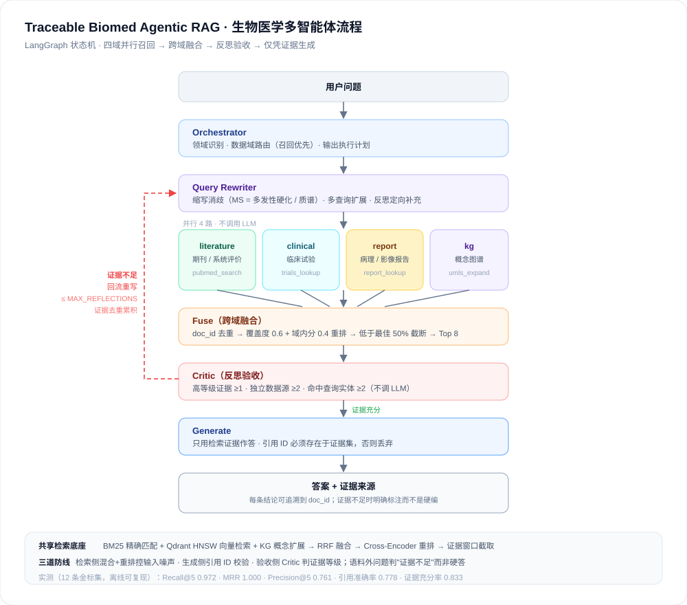

# Traceable Biomed Agentic RAG · Multi-Agent Decision Traces with Citation Provenance

[](LICENSE)
[](pyproject.toml)
[](tests)
[](https://github.com/a2012s/traceable-biomed-agentic-rag/actions)

[中文文档](README.md)

A reference implementation of multi-agent Agentic RAG built on **LangGraph**. Four domain-specific
agents retrieve in parallel; a cross-domain fusion node and a reflective Critic gate the result before
generation, so every claim carries a traceable citation.

> A domain-agnostic skeleton: planning and reflection live in the graph; domain knowledge lives in
> three replaceable modules (corpus, prompts, tools). See [docs/architecture.svg](docs/architecture.svg)
> for the full flow.



> ⚠️ **Data notice**: The bundled corpus is fictional teaching data. PMID / NCT identifiers are not
> associated with real records. **Not for any real medical decision.** See [DISCLAIMER.md](DISCLAIMER.md).

---

## 1. Quick Start

```bash
git clone git@github.com:a2012s/traceable-biomed-agentic-rag.git
cd traceable-biomed-agentic-rag

# No API key needed: Mock rule engine + local TF-IDF vectors + in-memory Qdrant, fully offline
uv venv .venv && source .venv/bin/activate
uv pip install -e ".[real-vector]"

python run.py "What is the diagnostic criteria for MS?"
python eval.py                                  # retrieval evaluation, seconds, no tokens burned
python -m unittest discover -s tests -t .       # 76 unit / behavior tests
```

`pip` works too: `pip install -e ".[real-vector]"`.

### Interactive Web Demo

A single page renders the runtime state directly: a decision-chain timeline (parallel fan-out and
reflection loop-back), evidence cards after cross-domain fusion, and clickable inline citations that
jump to the corresponding evidence.

```bash
uv pip install -e ".[web]"
uvicorn web.server:app --host 127.0.0.1 --port 8765
# open http://127.0.0.1:8765
```

The backend forces `LLM_PROVIDER=mock` before importing any business module — even if your local
`.env` holds a real key, the demo page will never trigger a paid call. Only `WEB_ALLOW_REAL_LLM=1`
lifts that guard. On shared deployments the page forwards `sharecode` to API requests.

## 2. Switching to a Real Model

```bash
cp .env.example .env
```

Fill in the key for any OpenAI-compatible provider (`LLM_PROVIDER` selects which one):

| Provider | `LLM_PROVIDER` | Required key |
|---|---|---|
| OpenAI | `openai` | `OPENAI_API_KEY` |
| DeepSeek | `deepseek` | `DEEPSEEK_API_KEY` |
| Alibaba Cloud Bailian | `dashscope` | `DASHSCOPE_API_KEY` |

An empty key or `LLM_PROVIDER=mock` falls back to the rule engine; the pipeline still runs.

**Latency tip**: If the main model is a reasoning model (e.g. `qwen4-max-preview`), point
`CHEAP_MODEL` at a non-reasoning one (e.g. `qwen-plus`) — query rewriting uses the cheap tier.
Measured: the rewriting node dropped from 134s to 12s, end-to-end from 265s to 30s.

## 3. What It Actually Solves

The problem with generic RAG isn't "no retrieval" — it's **not knowing when retrieval is wrong**:
single-path recalls miss, relevant hits rank low, retrieved content is off-topic, and generation
fills gaps with invention. This project puts one engineering constraint on each link:

| Stage | Approach | Problem removed |
|---|---|---|
| Query Rewriting | UMLS-style abbreviation sense disambiguation + multi-query expansion | "Wrong phrasing → wrong retrieval" (MS = multiple sclerosis / mass spectrometry) |
| Three-way hybrid recall | BM25 exact match + Qdrant HNSW vectors + KG concept expansion, fused with RRF | Single retriever blind spots: drug/gene names via BM25, semantics via vectors, concepts via KG |
| Cross-domain fusion | Dedupe by `doc_id` → global re-rank by score → drop fragments below 50% of the best | Concatenating each domain's Top-k hides all but the first domain; generic terms pollute citations |
| Critic reflection | Require ≥1 high-level evidence, ≥2 independent sources, ≥2 matched entities; otherwise loop back with an iteration cap | "Generating anyway when evidence is insufficient" |
| Human-in-the-loop checkpoint | When the graph would otherwise retrieve another round, it pauses at `human_review` with a review sheet; the human picks continue / refine with a note / abort and the graph resumes | "The mechanism can't tell whether to continue, so it either burns budget or refuses flatly" |
| Citation validation | Every citation in the answer must exist in the evidence set | Fabricated citations (the most detectable form of hallucination) |
| Out-of-corpus refusal | Score with "original question + abbreviation expansion" only, never the rewritten generic terms | Rewriter-added "systematic review" makes any document look relevant → false grounding |

## 4. Measured Results (offline, reproducible)

A 12-case golden set (9 dev / 3 test holdout) covering four data domains, abbreviation
disambiguation, and cross-domain distractors. `python eval.py` reproduces retrieval metrics in
seconds; `LLM_PROVIDER=mock python eval.py --full` reproduces end-to-end metrics without a key.
Every run writes per-case details and 95% bootstrap confidence intervals to `eval_runs/<timestamp>/`,
so a metric regression can be traced to specific cases.

**Reading note**: Row 1 is retrieval-only (pre-linking). Rows 2–3 use the pre-entity-linking
ablations and require `ENTITY_LINKING=0`. Row 4 is the current default (`ENTITY_LINKING=1`).
These are measurements under different configurations, not different versions of one configuration.

| Configuration | Recall@5 | MRR | Precision@5 | Citation precision | Distractor leakage | Evidence sufficiency |
|---|---|---|---|---|---|---|
| Single-path global retrieval (baseline) | 0.917 | 0.917 | 0.639 | — | — | — |
| Multi-agent · orchestrator-pruned domains (`WIDE_RECALL=0`) | 0.951 | 1.000 | 0.800 | 0.812 | 0.083 | 0.833 |
| Multi-agent · wide recall + cross-domain fusion (before entity linking) | **0.972** | **1.000** | 0.775 | 0.792 | 0.153 | **0.833** |
| **Multi-agent · wide recall + entity linking (default)** | 0.910 | 0.958 | **0.786** | **0.799** | **0.083** | 0.833 |

Reproduction commands (top to bottom):

```bash
ENTITY_LINKING=0 python eval.py                                              # baseline (retrieval-only)
WIDE_RECALL=0 ENTITY_LINKING=0 LLM_PROVIDER=mock python eval.py --full       # narrow recall
WIDE_RECALL=1 ENTITY_LINKING=0 LLM_PROVIDER=mock python eval.py --full       # wide recall (pre-linking)
LLM_PROVIDER=mock python eval.py --full                                      # default (linking on)
```

Same golden set and embedding throughout; only environment variables change. Running plain
`python eval.py` with `ENTITY_LINKING=1` (default) gives retrieval-only MRR 0.875, not the baseline's
0.917 — the expected effect of down-weighting the alternate sense of eGFR/EGFR.

The point of this table is not "the default is best" but **every change can be falsified by metrics**:

1. **Pruning domains still costs recall**: 0.972 wide → 0.951 narrow. Rule routing is incomplete
   ("brain MRI demyelination" matches no domain keyword, so the report domain never gets dispatched).
   Tool use recovers part of the gap (0.868 before tool selection, 0.951 after), but remains below
   wide recall. Hence `WIDE_RECALL=1` by default. The specialist agents don't call an LLM, so an
   extra route costs milliseconds while a missing route costs evidence.
2. **Fusion decides whether multi-source evidence reaches the prompt**: Concatenating each domain's
   Top-5 means generation sees only the first domain. Fusion dedupes by `doc_id`, re-ranks globally,
   and drops fragments below 50% of the best — MRR goes from 0.917 to 1.000.
3. **Scoring must use the disambiguated query**: Scoring with the rewriter's output let generic terms
   like "systematic review" mark out-of-corpus questions as "sufficiently evidenced". Substituting
   abbreviations with their contextual sense in place removed false grounding; the out-of-corpus
   case (CRISPR therapy for sickle cell disease) stably returns "insufficient evidence" — locked in
   by a unit test.
4. **State the trade-off**: Wide recall once raised distractor leakage from 0.083 to 0.153 in
   exchange for +0.104 recall and +0.083 MRR. Adding entity linking (default on) brought leakage
   back to 0.083 and lifted citation precision to 0.799 and Precision to 0.786, at the cost of
   recall 0.972 → 0.910 and MRR 1.000 → 0.958 — a deliberate trade of "one fewer wrong document
   cited" for "one fewer right document recalled". Set `ENTITY_LINKING=0` to return to recall-first;
   wide/narrow recall remains controlled by `WIDE_RECALL`.

LLM-driven tool selection (on by default, `TOOL_USE_ENABLED=0` to disable) feeds tool results
through the same reranker into the evidence chain. Measured end-to-end Precision rises 0.772→0.786
(default) and 0.772→0.800 (narrow recall), with citation precision rising accordingly and
distractor leakage unchanged — tool calls contribute to the answer, not just to the trace.

> Small-sample caveat: 12 cases (9 dev / 3 test) serve **regression comparison**, not production
> accuracy. Default 95% bootstrap intervals: Recall [0.75, 1.0], MRR [0.667, 1.0], Precision
> [0.456, 0.822] — wide enough that 0.910 vs 0.972 cannot be distinguished from noise. The split
> report confirms it: dev Recall 1.000 vs test 0.667. Don't quote absolute values as precision.

## 5. Code Layout

```
src/
├─ agents/
│  ├─ graph.py        state machine: conditional edges, fan-out, reflection, HITL interrupt, checkpointer
│  ├─ nodes.py        orchestrator / rewriter / tool use / domain agents (factory) / fusion / critic / review / generate
│  ├─ prompts.py      centralized prompts for iteration and evaluation
│  └─ tool_params.py  tool argument extraction: query ∩ corpus vocabulary, no hardcoded domain nouns
├─ rag/
│  ├─ retriever.py    BM25 + vector + KG recall, fused with RRF
│  ├─ reranker.py     IDF-weighted cosine scoring (cross-encoder placeholder) + fusion + evidence window
│  ├─ embedding.py    pluggable embeddings: hash / tfidf / api (real model)
│  └─ vector_store.py Qdrant local HNSW + numpy fallback behind one interface
├─ tools/biomedical.py  single ToolSpec registry: Pydantic validation, async, error bifurcation, MCP schema
├─ eval/               golden set, retrieval/generation metrics, runner (bootstrap CI, per-case jsonl)
├─ deps.py             lazy dependency container (import does not build an index)
├─ state.py            shared state and reducers (dedup-accumulate / additive metering)
└─ llm.py              real/Mock dual mode, tiered routing, exponential backoff, real token accounting

web/
├─ server.py           FastAPI: /api/ask (with the interrupted contract), /api/ask/resume, SSE, metrics
└─ index.html          single-page demo: decision chain, evidence cards, citation highlight, review panel
```

## 6. Design Decisions and Why

| Decision | Approach | Why |
|---|---|---|
| Split agents by data domain, not by function | literature / clinical / report / kg each own their source and tools | Domains are heterogeneous with different permission boundaries; splitting enables parallel recall, independent scaling, and separate evaluation |
| State machine over prompt chain | `StateGraph` + conditional edges + `MemorySaver` | Reflection is a cyclic graph requiring explicit iteration caps and resumability; a conversational chain can't express rollback |
| Separate recall from scoring | Rewritten query is used for **recall only**; scoring uses "original question + abbreviation expansion" | Widening recall inevitably introduces generic terms; scoring with them makes unrelated topics look "covered" |
| Accumulate evidence with dedupe, not reset | Reducer merges by `doc_id`, keeping higher scores | The earlier "reflection clears evidence" design discarded valid evidence from prior rounds, so more reflection made results worse |
| Pick the sense by context for ambiguous abbreviations | Cue-word table (diagnosis/imaging → disease sense; quantification/chromatography → method sense); keep all senses only with no cue | Expanding every sense makes a "diagnostic criteria" question retrieve and cite mass-spectrometry methodology papers |
| Relative-score cutoff after fusion | Drop fragments below 50% of the best evidence | An accidental single-term hit (`mass effect` colliding with `mass spectrometry`) pollutes citations; absolute thresholds aren't comparable across queries |
| Lazy dependency loading | `lru_cache` in `deps.py` | Building an index at module import makes every import pay the full cost and prevents tests from injecting replacements |
| Error bifurcation | Timeout / 429 → exponential backoff; invalid args / unknown tool → fail immediately | The former is recoverable and worth retrying; the latter only amplifies cost |
| Single registry | `ToolSpec(name, schema, handler, description)` | Handlers and schemas maintained separately meant forgetting one when adding a tool; now MCP schemas export directly |
| LLM-driven tool selection | `tool_use` node runs in parallel with the rewriter; the model picks tools from their schemas and results enter the evidence chain | A fixed tool mapping is trace decoration; measured +0.014 Precision and +0.014 citation precision on the default config |
| Multi-turn passes text, not state | `history` feeds Q/A text to the rewriter for coreference only; the thread's internal state is not reused | Reusing state leaks the previous turn's evidences/reflection_count into a new question — the classic "conversation gets worse over time" bug |
| HITL as an in-graph interrupt, not an external queue | `interrupt()` pauses at `human_review`; `Command(resume=...)` continues from that point | The checkpoint holds the paused state, so a human decision doesn't re-run prior retrieval and reflection; an external queue would have to persist intermediate state itself |
| HITL off by default | `HITL_ENABLED=0`; only the web demo turns it on | `eval.py` and batch jobs are unattended — an interrupt leaves the process waiting for a human and would hang offline evaluation |
| Hold out an evaluation split | 12 cases split 9 dev / 3 test; test is not tuned on; per-case jsonl plus bootstrap CI | Tuning and reporting on the same cases is optimistic; the split report shows dev Recall 1.000 vs test 0.667 |
| Tests forced offline | `tests/__init__.py` sets `LLM_PROVIDER=mock` | Otherwise local test runs hit the paid API in `.env` (happened in practice) |

## 7. What's Real vs. Simulated

Honest labeling beats looking complete — stating real boundaries lets users judge whether the project fits their needs:

| Module | Status |
|---|---|
| LangGraph orchestration, conditional edges, reflection, state reducers | ✅ Real implementation |
| Three-way recall + RRF + re-ranking + evidence window | ✅ Real algorithms (re-ranking is feature scoring, not a neural model) |
| Qdrant local HNSW / numpy fallback / index rebuild on dimension change | ✅ Real implementation |
| TF-IDF embedding | ✅ Real computation (offline, not a semantic model) |
| hash embedding | ⚠️ Fallback, semantically weak; crc32 projection makes it reproducible across processes (not randomized `hash()`) |
| Cross-encoder re-ranking | ⚠️ Simulated with IDF-weighted cosine + priors; swap `score()` for bge-reranker |
| Four biomedical tools | ⚠️ Backed by local corpus; replace `pubmed_search` etc. with real APIs |
| LLM tool selection | ✅ Real call chain (model output → Pydantic validation → dispatch → reranker → evidence); mock mode simulates it with domain rules |
| Multi-turn coreference | ⚠️ Context passing and cache isolation are real; mock mode resolves by vocabulary lookup, a real model does it via prompt |
| 95% confidence intervals | ✅ Bootstrap resampling; but with n=12 the interval is wide, so it expresses uncertainty rather than significance |
| Human-in-the-loop checkpoint | ✅ Real pause/resume through LangGraph `interrupt` + `Command(resume)`, with three distinct exits; how long the pause survives depends on the checkpointer |
| Critic | ⚠️ Rule-based (interpretable, zero cost), not an LLM judge |
| Corpus | ⚠️ Fictional teaching data, identifiers unrelated to real records |

Going production touches only three places: `build_index()` → real data source,
`EMBEDDING_BACKEND=api` → domain embedding, `CrossEncoderReranker.score()` → a real re-ranking model.
The orchestration layer stays untouched.

## 7.5 Production-Oriented Additions

All of the following are **off by default or degrade to original behavior**; the out-of-the-box
offline demo is unaffected. Configuration keys are in `.env.example`.

| Capability | Switch | Implementation and rationale |
|---|---|---|
| Persistent checkpoints | `CHECKPOINTER=sqlite` + `uv pip install -e ".[production]"` | Replaces `MemorySaver` so restarts / multiple workers can resume by `thread_id`; missing dependency falls back to memory with a warning |
| Concurrency and timeouts | `MAX_CONCURRENCY` / `REQUEST_TIMEOUT_S` | Web-layer `Semaphore` + `wait_for` prevent many requests from saturating retrieval threads |
| Observability | On by default | `X-Request-ID` spans headers and body; `/api/metrics` reports request counts, errors, P50/P95/P99, cache hit rate |
| Answer cache | `ANSWER_CACHE_TTL_S` | Key includes corpus digest, embedding/retrieval config, and model tier — a config change can't serve a stale answer |
| Entity linking | `ENTITY_LINKING=1` | `eGFR` (kidney function) and `EGFR` (gene) are homographs; the alternate sense is down-weighted, not hard-deleted; end-to-end leakage 0.153 → 0.083 |
| External re-ranking | `RERANKER_API_URL` | POST `{query,text}` → `{score}` to a real cross-encoder; failures trip a circuit breaker and fall back to built-in scoring |
| Streaming endpoint | On by default | `POST /api/ask/stream` (SSE); currently one frame per completed pipeline — token-level requires changes to the generate node |
| Feedback loop | `FEEDBACK_ENABLED=1` | `/api/feedback` + `/api/feedback/summary`, transactional SQLite writes, **question hashes only, never raw text** |
| Retrieval robustness | `FUSE_MIN_KEEP` / `RRF_K` / `RERANK_CANDIDATES` | Fusion floor prevents "outlier best score → single evidence → guaranteed refusal"; RRF filters by domain before assigning ranks; re-ranking only sees the top N candidates |
| Cost gate | `MAX_TOKENS_PER_REQUEST` | Beyond the iteration cap, reflection also stops on a token budget or on zero new evidence, so exhausted queries don't spin |
| Re-ranker circuit breaker | `RERANKER_TIMEOUT_S` / `RERANKER_BREAKER_COOLDOWN_S` | Batched request (no per-document HTTP) + instance-level breaker that never mutates global config |
| Human-in-the-loop checkpoint | `HITL_ENABLED=1` | When the Critic finds evidence insufficient and the graph would retrieve again, `POST /api/ask` returns `interrupted=true` plus a review sheet; `POST /api/ask/resume` takes `thread_id` and a decision (see the snippet below) |

The three decisions: `approve` continues generating with the caveat (evidence unchanged, `grounded`
stays false); `refine` folds the human note into `query_focus` and runs one more retrieval round
(counted against `MAX_REFLECTIONS`, so repeated clicks can't bypass the cap); `abort` goes to a
dedicated `refuse` node and **never calls the generation model**.

```bash
# 1) Interrupt: the Critic finds the evidence insufficient, the graph pauses at human_review
curl -s localhost:8765/api/ask -H 'Content-Type: application/json' \
  -d '{"question":"Applications of mass spectrometry in serum protein quantification"}'
# → {"interrupted": true, "thread_id": "web-…", "review": {"critique": "…", "options": [...] }}

# 2) Resume with one of the three decisions, optionally with a note
curl -s localhost:8765/api/ask/resume -H 'Content-Type: application/json' \
  -d '{"thread_id":"web-…","decision":"refine","note":"serum protein quantification only"}'
# → {"interrupted": false, "review_decision": "refine", "reflection_count": 1, "answer": "…"}
```

Resuming a finished thread returns 409 (it never silently re-runs and charges twice); an unknown
`decision` returns 422.

Measured: `python -m unittest discover -s tests -t .` passes 76 tests; `python eval.py` and
`python eval.py --full` show no metric regression.

Still demo-scope and not claimed as done: real corpus and version filtering, token-level streaming,
cross-instance shared checkpoints/metrics/feedback (currently process-local), and rate limiting plus
authentication (currently only a concurrency cap). These need external resources; interfaces are
left in place rather than faked.

## 8. Domain Migration

Only three places bind to the domain: `src/data/corpus.py` (data source and chunking),
`src/agents/prompts.py` (terminology and evidence criteria), and `src/tools/biomedical.py` (external
tools). The state machine, reflection, fusion, citation validation, error bifurcation, and token
accounting are all domain-agnostic.

Moving to codebase Q&A (e.g. AOSP customizations) requires three additional pieces this project does
not claim to support: AST-level chunking (tree-sitter, don't break functions at character boundaries),
symbol indexing and call graphs (LSP / ctags to complete call chains), and a version dimension in
state (evidence tagged with branch/tag, Critic filtering cross-version evidence).

## 9. Known Limitations

- Only 15 documents, so retrieval metrics are optimistic; `retrieve_top_k=50` is near-full recall
- TF-IDF has no semantics; synonym queries with different wording won't be recalled — switch to `EMBEDDING_BACKEND=api`
- The Critic uses rules, not an LLM judge; complex conflicting evidence is judged imprecisely
- In Mock mode the orchestrator and rewriter are rule engines covering only the sample phrasings
- Streaming emits one frame per completed pipeline, not token-level; the concurrency cap is a
  process-local `Semaphore` with no sharing across workers; the result cache is a process-local TTL
- Entity linking down-weights homograph collisions (leakage 0.153 → 0.083) but is still rule-based,
  not UMLS entity linking; `eGFR` (kidney function) and `EGFR` (gene) can still mis-recall in more
  complex contexts
- The re-ranker is an IDF-weighted cosine approximation, not a real cross-encoder; semantic
  paraphrase queries still need `EMBEDDING_BACKEND=api`
- The HITL pause lives in the checkpointer: with `CHECKPOINTER=memory` (default) it is lost on
  restart and not shared across workers — production needs `sqlite`/Redis for reviews to survive

## 10. Five Core Design Takeaways

1. **Multi-agent isn't the goal**: "agentic" means retrieval decisions enter a reflective loop,
   independent of agent count. The reason for splitting here is heterogeneous data domains and
   tool-permission boundaries — not looking sophisticated.
2. **A cyclic graph needs a state machine**: Reflection rollback, iteration caps, and resumability
   can't be expressed as a prompt chain.
3. **Recall and scoring must be separated**: This is the root cause of "false grounding" —
   rewriting widens recall while simultaneously corrupting relevance judgment.
4. **Metrics must be able to falsify your choices**: The four rows in §4 are ablations toggling one
   variable on the same golden set; the default is a measured trade-off, not a hunch, and both the
   leakage gain and recall loss from entity linking are stated.
5. **Label the gaps honestly**: Saying which parts are simulated and which aren't implemented (AST
   chunking, version dimension) is more credible than claiming everything works.

## 11. Demo Questions (all verified)

| Question | What you'll see |
|---|---|
| `What is the first-line treatment for EGFR-mutated non-small cell lung cancer?` | Literature + clinical trial + KG domains hit simultaneously, passing the Critic on the first round; report-domain evidence is cut at fusion for insufficient relevance (`VERBOSE=1` shows candidate counts before/after pruning) |
| `What is the diagnostic criteria for MS?` | Abbreviation disambiguation works: only multiple sclerosis is expanded; mass-spectrometry methodology papers stay out of citations |
| `Applications of mass spectrometry in serum protein quantification` | Insufficient evidence level → multiple reflection loop-backs → honestly labeled "insufficient evidence" |
| `Long-term safety of CRISPR base editing in sickle cell disease?` | Out-of-corpus question: empty evidence, `grounded=False`, explicit refusal after hitting the iteration cap |
| `Applications of mass spectrometry in serum protein quantification` (with `HITL_ENABLED=1`) | The Critic finds evidence insufficient → the graph pauses with a review sheet; `refine` runs one more round with your note, `abort` refuses without calling the generation model |

```bash
VERBOSE=1 python run.py "Applications of mass spectrometry in serum protein quantification"  # live decision chain
HITL_ENABLED=1 uvicorn web.server:app --port 8765                                          # enable the review panel
```

> The out-of-corpus (CRISPR) case does not pause for review: zero evidence means retrieval is
> exhausted, so asking a human adds noise — the graph goes straight to refusal.

## 12. Open Source and Contributing

- License: MIT (see [LICENSE](LICENSE))
- Data and disclaimer: [DISCLAIMER.md](DISCLAIMER.md)
- Contributing guide: [CONTRIBUTING.md](CONTRIBUTING.md) (Chinese)
- Install the secret-scanning hook before committing (prevents accidental `.env` commits):
  ```bash
  cp scripts/pre-commit .git/hooks/pre-commit && chmod +x .git/hooks/pre-commit
  ```
